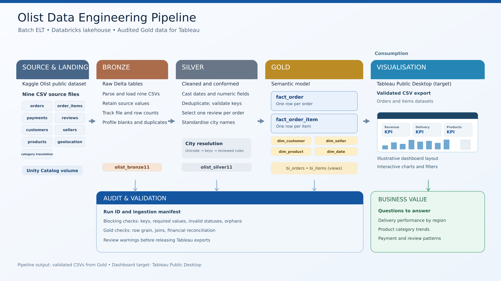

# Olist E-commerce Analytics
### From raw marketplace data to validated analytical tables and business dashboards

A completed team capstone using **Databricks, Python/PySpark, SQL, Tableau Public, and Power BI** to examine sales, delivery performance, and customer experience in the Brazilian Olist marketplace.

**Business question:** How do sales and delivery service vary over time, across product categories, and between customer locations?

## Explore the project

| Resource | What you can review |
| --- | --- |
| [Pipeline notebook](notebooks/olist_pipeline.ipynb) | Ingestion, cleaning, analytical modelling, and validation |
| [Power BI dashboard](dashboards/powerbi/Team_3_PowerBI_Dashboard.pbix) | Download the report and open it in Power BI Desktop |
| [Tableau workbook](dashboards/tableau/Final%20Project-Olist%20Dashboard_v2%201.twb) | Inspect the Tableau workbook; local CSV connections require exported data |
| [Architecture diagram](images/medallion_architecture.png) | Pipeline stages and data flow |

The Tableau Public dashboard was published as part of the project. Its live URL has not yet been added to this portfolio. The workbook is included above.

## Architecture

Nine source CSV files are loaded into Delta tables using a batch ELT workflow:

- **Bronze:** preserve source data for traceability.
- **Silver:** standardize types, remove duplicates, clean strings and geographic names, and handle invalid or missing values.
- **Gold:** prepare dimensions and fact tables for business analysis.
- **Audit:** record run metadata and data-quality results.
- **Reporting:** export analytical tables for Tableau and Power BI.

## Engineering decisions

| Decision | Why it matters |
| --- | --- |
| Separate order-grain and item-grain facts | Preserve the appropriate grain for order KPIs and product analysis; avoid multiplying order-level measures |
| Aggregate multiple payments per order before joining | Prevent one-to-many payment records from inflating totals |
| Standardize geographic labels using city and state | Reduce inconsistent location labels and ambiguous city matches |
| Track pipeline runs with a UUID | Associate outputs and audit records with a specific execution |
| Use overwrite-based batch outputs | Allow repeat runs to replace the analytical snapshot |

## Data quality and validation

The pipeline includes duplicate and NULL checks on keys, type-casting checks with audit records, geographic-cleaning audit trails, item/payment reconciliation, and business-rule tests. Control totals were compared between Databricks and the dashboards.

These checks make metric discrepancies visible before the results are interpreted. Snapshot overwrite is appropriate for this historical batch project; it does not demonstrate incremental ingestion or production scheduling.

## Business findings

The original project analysis reported:

- **Order concentration:** São Paulo accounted for approximately 42% of orders (41,746 of the 99,441-order source baseline), followed by Rio de Janeiro and Minas Gerais.
- **Regional delivery differences:** The ten states with the longest average delivery times were in the North or Northeast and represented approximately 4.7% of orders.
- **Sample size matters:** Roraima averaged 29.3 delivery days on only 46 orders. Higher-volume states, including Ceará, Pará, and Maranhão, also showed long average delivery times, supporting further investigation.

**Recommended next steps:** Prioritize operational investigation where delivery delays coincide with meaningful order volumes; assess seller location and shipping routes; and test interventions before expanding them. Descriptive patterns alone do not establish causes.

## Reading the metrics

The source repository defines delivered GMV as delivered item prices **excluding freight**, AOV as delivered GMV divided by delivered orders, and on-time delivery as eligible delivered orders arriving by the estimated date. These definitions should be checked against each dashboard calculation before comparing views.

The source contains **99,441 orders**. The final Tableau reporting window of **September 2016 to August 2018** contains **99,421 orders**. These are different date scopes, so the baseline is not a dashboard total. Figures also depend on status, state, and other filters.

## Scope and limitations

- Historical Brazilian marketplace data from 2016–2018; findings are not current market estimates.
- September and October 2018 are incomplete and excluded from the final Tableau reporting window.
- Sparse states and early months require caution when comparing averages.
- Raw Kaggle CSVs and exported dashboard CSVs are not bundled here.
- The Tableau `.twb` references local CSV files and is not a self-contained packaged workbook.
- This portfolio demonstrates batch data engineering and BI analysis, rather than a deployed production service.

## Team and contribution

Created by **Amelia, Clarence, Fauzi, and Riani** for the Generation Singapore Junior Data Engineer programme.

**Clarence — team lead and primary contributor.** This portfolio presents the shared team deliverables and retains team attribution.

## Dataset

[Olist Brazilian E-Commerce Public Dataset on Kaggle](https://www.kaggle.com/datasets/olistbr/brazilian-ecommerce), provided by Olist.

This portfolio branch curates the original capstone assets for technical and hiring review. Trainer replication guides and assessment documents are omitted.
